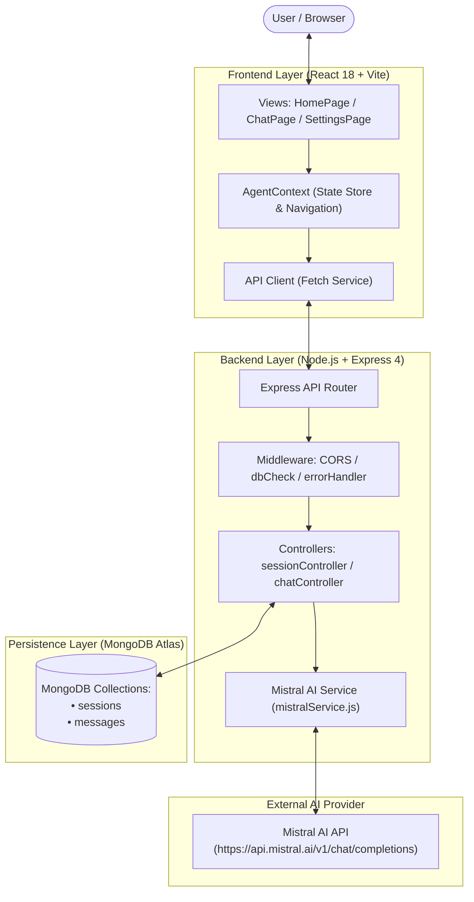
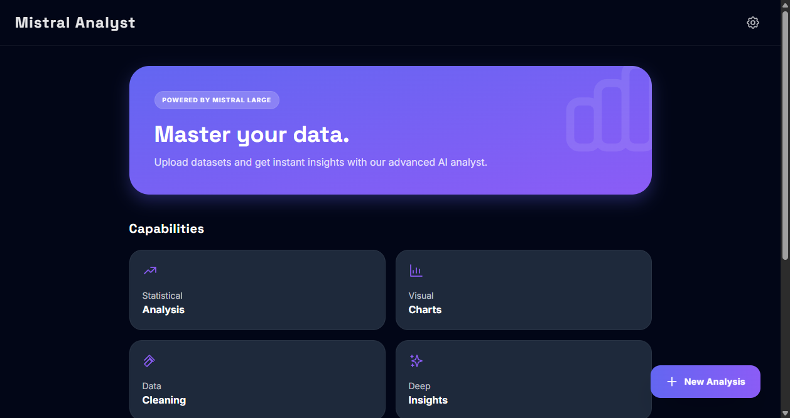
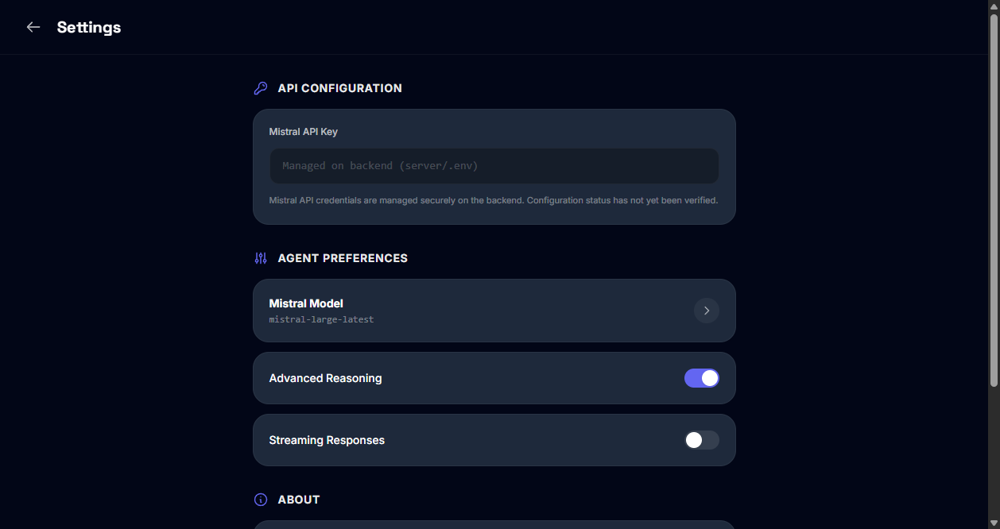
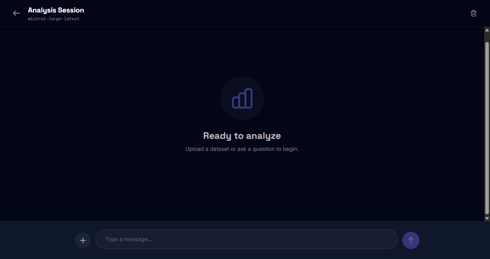
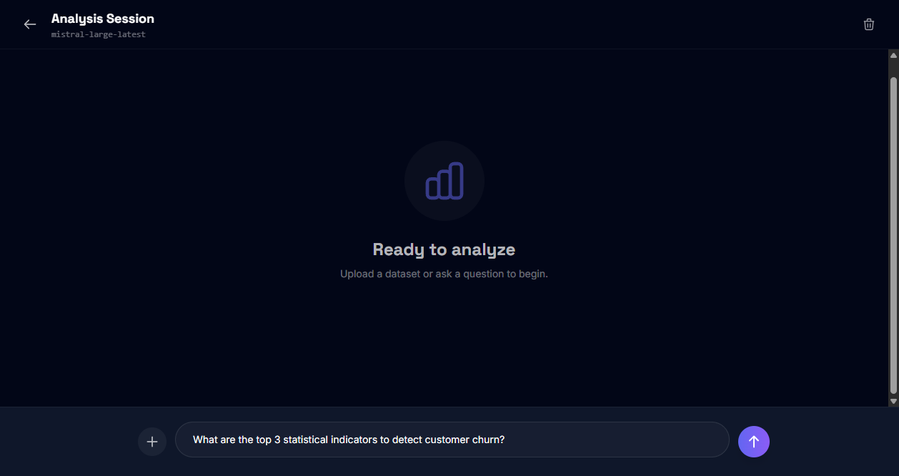

# Analyst Agent — v1.0.0

An AI-assisted data analysis web application integrating the Mistral AI API with a decoupled MERN stack and persistent conversation history.

---

## Overview

### Problem Statement
Exploratory data analysis often involves repetitive tasks: calculating descriptive statistics, diagnosing data cleaning requirements, structuring visual charts, and extracting initial insights. While large language models can assist with these workflows, developers and data practitioners need lightweight, persistent web interfaces that maintain conversation context across sessions without heavy third-party dependencies.

### Solution & Target Users
**Analyst Agent** provides an interactive web workspace for data analysts, students, and engineers. Users can initiate isolated analysis sessions, submit exploratory questions, receive structured Markdown recommendations, and persist message histories across server restarts in MongoDB Atlas.

### Architectural Rationale
- **Decoupled Architecture:** The React/Vite client never accesses third-party API credentials directly. All prompt preparation, credential management, and provider communication are isolated within the Express API server.
- **Fail-Fast Database Circuit Breaker:** The server employs a Mongoose connection gatekeeper (`requireDatabase`) that gracefully responds with HTTP 503 (`DATABASE_UNAVAILABLE`) if MongoDB is unreachable, preventing unhandled promise rejections.
- **Zero-Dependency Routing:** Client navigation leverages React context synchronized with the browser History API (`window.history.pushState`), eliminating external router packages while preserving browser back/forward capabilities.

---

## System Architecture

The following diagram illustrates the component architecture and data flow across client, backend, persistence, and external AI services:



### Request Lifecycle
1. The user inputs a message in the chat interface.
2. The client optimistically renders the user message and dispatches `POST /api/chat/completions`.
3. The Express controller verifies database connectivity, validates input fields, and persists the user message to MongoDB.
4. The controller retrieves chronological conversation history from MongoDB.
5. The backend sanitizes history (stripping unauthorized roles), prepends the trusted system prompt, and forwards the payload to Mistral AI via `mistralService.js`.
6. Upon a successful response, the assistant message is persisted to MongoDB and returned to the client. If an upstream error occurs (e.g. 401, 429), an error message bubble is persisted with `isError: true` and returned with an appropriate HTTP error status.

---

## Application Screenshots

The following screenshots were captured directly from the running v1.0.0 application:

| Landing Dashboard (`HomePage`) | Settings & Credentials (`SettingsPage`) |
| :---: | :---: |
|  |  |
| *Hero banner, capabilities overview, and "New Analysis" trigger* | *API credential notice and active model selection tile* |

| Analysis Session (`ChatPage`) | Conversational Interaction |
| :---: | :---: |
|  |  |
| *Clean message stream with simulated attachment trigger* | *Live conversation turn rendering structured analytical guidance* |

---

## Key Features

- **Conversational Data Analysis:** Submit natural language prompts to explore datasets, discuss cleaning techniques, and structure analytical workflows.
- **Persistent Sessions & Messages:** Session metadata and chronological message records are stored in MongoDB Atlas and survive backend restarts.
- **Upstream Resilience & Error Handling:** Comprehensive error classification for missing credentials, invalid session IDs, network timeouts, and provider rate limits.
- **Custom Markdown Rendering:** Built-in zero-dependency parser rendering headers, bold text, bullet points, blockquotes, inline code, and syntax blocks.
- **Stack-Based Browser Navigation:** Seamless transitions between Home, Chat, and Settings synchronized with browser back/forward buttons.
- **Unified Dark Theme:** Responsive UI styled with Tailwind CSS conforming to a slate/indigo palette.

---

## Technology Stack

| Layer | Technologies | Purpose |
| :--- | :--- | :--- |
| **Frontend** | React 18, Vite 5, Tailwind CSS 3 | Single-page application, build tooling, dark theme |
| **Backend** | Node.js (v20+ / v24), Express 4 | RESTful API server, middleware, error handling |
| **Database** | MongoDB Atlas, Mongoose 8 | Document persistence, schemas, compound indexes |
| **AI Integration** | Mistral AI REST API, native `fetch` | LLM completions (`mistral-large-latest` default) |
| **Testing** | Node.js Native Test Runner (`assert`) | 28 automated tests across backend, client, and UI |

---

## Project Structure

```text
Analyst_Agent/
├── .gitignore                     # Repository ignore patterns (protects .env variants)
├── package.json                   # Root workspace scripts and repository metadata
├── CONTRIBUTING.md                # Development guidelines and branch isolation policy
├── README.md                      # Primary project documentation
├── docs/                          # Detailed engineering documentation
│   ├── api/
│   │   └── endpoints.md           # Complete REST API specification
│   ├── architecture/
│   │   └── system-design.md       # Architecture diagrams and schema models
│   ├── deployment/
│   │   └── render-guide.md        # Render free-tier hosting blueprint
│   ├── screenshots/               # Verified application screenshot gallery
│   │   ├── 01_home_screen.png
│   │   ├── 02_settings_screen.png
│   │   ├── 03_chat_screen.png
│   │   └── 04_chat_response.png
│   └── testing/
│       └── verification.md        # Test suite audit and execution record
├── client/                        # React 18 + Vite frontend workspace
│   ├── index.html                 # HTML entry point with dark theme class
│   ├── vite.config.js             # Vite configuration with /api backend proxy
│   ├── tailwind.config.js         # Palette colors (brand-primary, scaffold, card)
│   ├── test_phase3.js             # Client foundation and security tests
│   ├── test_phase4.js             # Client UI parity and renderer tests
│   └── src/
│       ├── main.jsx               # React DOM root mounting
│       ├── App.jsx                # Application root and router switch
│       ├── context/               # AgentContext state store
│       ├── pages/                 # HomePage, ChatPage, SettingsPage
│       ├── components/            # Icons, MarkdownRenderer
│       └── services/              # API HTTP client
└── server/                        # Node.js + Express backend workspace
    ├── .env.example               # Environment template with placeholders
    ├── test/
    │   └── test_phase2.js         # Backend integration and security test suite
    └── src/
        ├── server.js              # Express app bootstrap, CORS, and health check
        ├── config/db.js           # Mongoose connection configuration
        ├── middleware/            # dbCheck (503 circuit breaker), errorHandler
        ├── models/                # Session and Message Mongoose schemas
        ├── routes/                # sessionRoutes, chatRoutes
        ├── controllers/           # sessionController, chatController
        └── services/              # mistralService (AI completion engine)
```

---

## AI Inference & Model Verification

- **Configured Model:** The codebase configures `mistral-large-latest` by default across server defaults (`server/src/services/mistralService.js`, `server/src/models/Session.js`) and client session initiation (`client/src/pages/HomePage.jsx`).
- **Account Entitlement Observations:** During live integration testing, the configured test API account returned HTTP 403 Forbidden when requesting `mistral-large-latest`, indicating that access to this model depends on specific account entitlements or plan tiers. Live requests using smaller models (such as `ministral-8b-latest`) completed successfully under the same test credentials.
- **Prompt Templating:** The server prepends a fixed system prompt (`SYSTEM_PROMPT`) defining the assistant's analytical scope and filters user conversation history to prevent prompt overriding.
- **Timeout Management:** All inference calls are gated by a 60-second `AbortSignal.timeout(60000)` to ensure backend workers do not hang on degraded connections.

---

## API Summary

| Method | Endpoint | Description |
| :--- | :--- | :--- |
| `GET` | `/api/health` | Service status, MongoDB connection state, and key configuration check |
| `POST` | `/api/sessions` | Create a new analysis session entity |
| `GET` | `/api/sessions/:id` | Retrieve session details and chronological message history |
| `DELETE` | `/api/sessions/:id/messages` | Clear conversation messages for a session (preserves session) |
| `POST` | `/api/chat/completions` | Dispatch user prompt, persist message, query Mistral, persist response |

*For complete request schemas, response examples, and validation rules, see the [API Reference](docs/api/endpoints.md).*

---

## Installation & Setup

### Prerequisites
- [Node.js](https://nodejs.org/) v20.x or v24.x LTS
- [npm](https://www.npmjs.com/) v10.x+
- A [MongoDB Atlas](https://www.mongodb.com/atlas) connection URI or local MongoDB instance
- A [Mistral AI](https://console.mistral.ai/) API key

### Step 1: Clone the Repository
```powershell
git clone https://github.com/ydv-prince/Analyst_agent.git
cd Analyst_agent
```

### Step 2: Install Dependencies
```powershell
# Install server dependencies
cd server
npm install
cd ..

# Install client dependencies
cd client
npm install
cd ..
```

### Step 3: Configure Environment Variables
Create a `.env` file in the `server/` directory:
```powershell
cp server/.env.example server/.env
```

Edit `server/.env` with your actual settings:
```env
PORT=5000
CLIENT_URL=http://localhost:5173
MONGODB_URI=mongodb://localhost:27017/analyst_agent
MISTRAL_API_KEY=your_mistral_api_key_here
```

### Step 4: Run the Application
Open two separate terminal windows:

**Terminal 1 (Backend Server):**
```powershell
npm run server
```

**Terminal 2 (Frontend Client):**
```powershell
npm run client
```

Navigate to `http://localhost:5173/` in your browser.

---

## Automated Verification & Testing

Analyst Agent includes automated test suites covering backend API contracts, schema validation, client contracts, and UI parity.

Run all test suites from the root directory:
```powershell
npm test
```

### Verified Test Breakdown
```text
> analyst-agent@1.0.0 test
> node server/test/test_phase2.js && node client/test_phase3.js && node client/test_phase4.js

======================================================================
PHASE 2 BACKEND TEST SUITE: 12 PASSED, 0 FAILED (1 SKIPPED LIVE CALL)
======================================================================
PHASE 3 FRONTEND & STATE INTEGRATION TEST SUITE: 8 PASSED, 0 FAILED
======================================================================
PHASE 4 UI REPLICATION & INTEGRATION TEST SUITE: 8 PASSED, 0 FAILED
======================================================================
TOTAL: 28 PASSED, 0 FAILED across 3 test suites
```

To run individual suites:
```powershell
npm run test:server    # Backend integration tests
npm run test:client    # Client integration and UI tests
npm run build          # Production frontend build validation
```

*For complete test execution logs, see [Verification Record](docs/testing/verification.md).*

---

## Deployment

Analyst Agent is structured for deployment on cloud platforms such as Render. The client builds into a static directory (`client/dist`), while the backend runs as an Express Web Service connecting to MongoDB Atlas.

*For complete deployment instructions, see the [Render Deployment Guide](docs/deployment/render-guide.md).*

---

## Scope & Known Limitations (v1.0.0)

- **Anonymous Sessions:** Analyst Agent v1.0.0 is an anonymous, single-tenant application. It does not include multi-user login, registration, or tenant data isolation (multi-user authentication is part of the v2 roadmap).
- **Single Provider Configuration:** v1.0.0 supports Mistral AI via server-side environment variables. It does not provide a dynamic multi-provider Bring Your Own Key (BYOK) vault.
- **Simulated Attachments:** The attachment selector in the chat view populates an analysis prompt referencing the chosen filename; it does not parse binary CSV/Excel spreadsheets on the server.
- **Provider Account Entitlements:** Live chat completions require an active Mistral API key with entitlement to access the configured model (`mistral-large-latest`). During verification, the test account received HTTP 403 when invoking `mistral-large-latest`.

---

## Future Roadmap (v2.0.0)

The active `v2` development branch builds upon this foundation to introduce:
- **Multi-User Identity:** JWT authentication and Google OAuth 2.0 with session security.
- **Secure BYOK Vault:** Envelope-encrypted storage (AES-256-GCM) for user-supplied API keys.
- **Universal Multi-Provider Support:** Dynamic adapters for Google Gemini, OpenAI, and Anthropic Claude.
- **Multi-Tenant Data Isolation:** User-owned conversation histories with strict access control.

---

## License

This project is licensed under the terms of the [MIT License](LICENSE).


