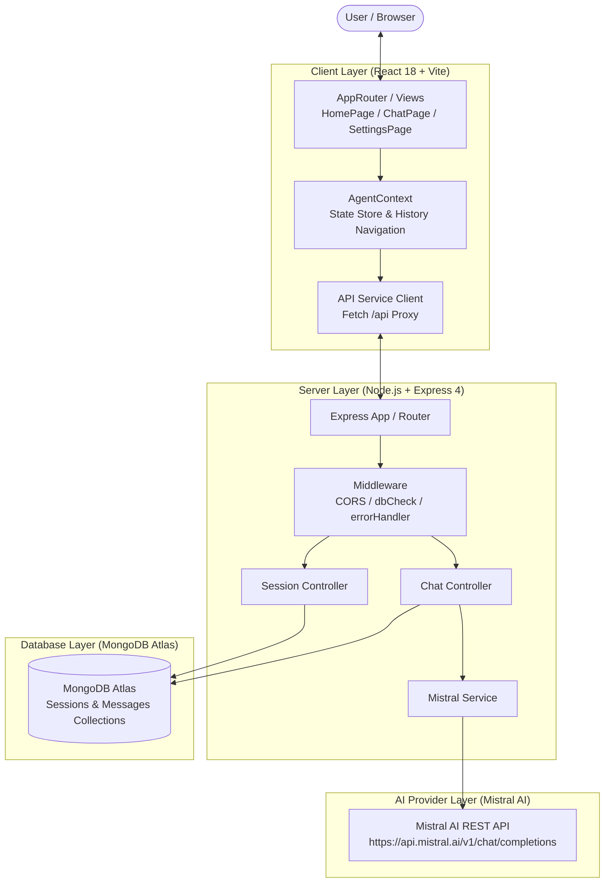
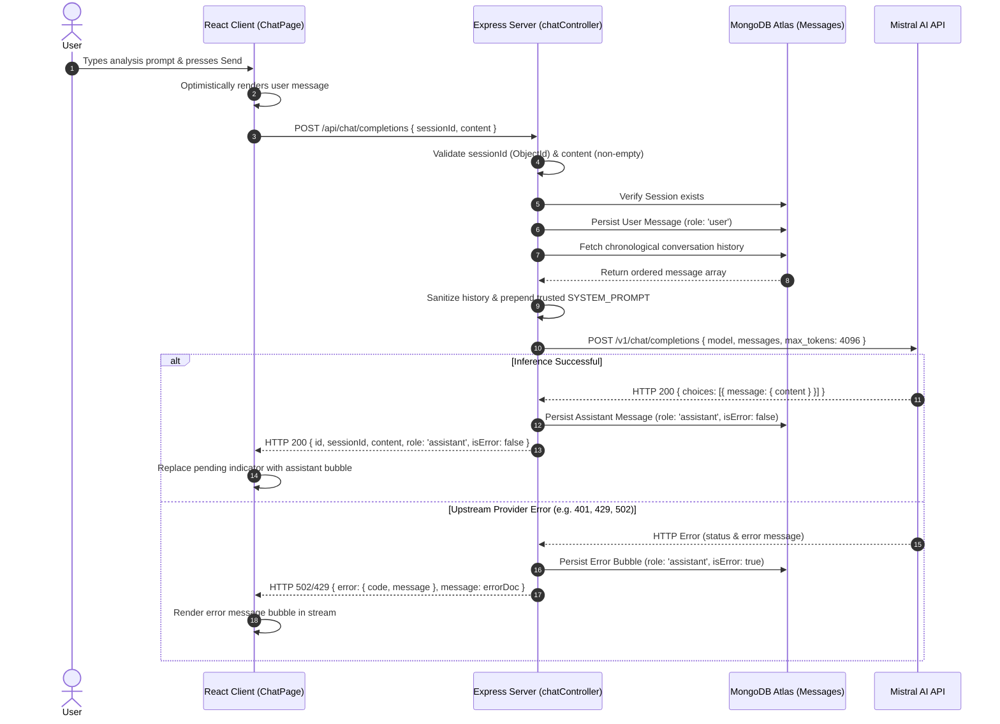

# System Architecture & Design — Analyst Agent v1.0.0

## 1. Overview

Analyst Agent v1.0.0 is an interactive AI-assisted data analysis application built on the MERN stack (MongoDB, Express, React, Node.js). The architecture decouples the frontend client from backend API operations and isolates third-party AI provider communication entirely within the Express service layer.



---

## 2. Frontend / Backend Separation

### Client Architecture
- **Single Page Application:** React 18 powered by Vite.
- **Styling:** Tailwind CSS with a unified dark theme palette (`#0F172A` scaffold, `#1E293B` cards, `#6366F1` indigo primary, `#EC4899` pink secondary).
- **Navigation:** Stack-based routing managed in `AgentContext.jsx` synchronized with the browser's History API (`window.history.pushState` and `window.onpopstate`). This eliminates third-party routing dependencies while supporting natural browser back/forward navigation.
- **Markdown Processing:** Zero-dependency regex tokenizer (`MarkdownRenderer.jsx`) that parses headers, bold, italics, lists, blockquotes, inline code, and syntax blocks.

### Backend Architecture
- **RESTful API:** Express 4 server configured with JSON body parsing (1MB limit) and strict CORS origins.
- **Decoupled AI Communication:** The client never communicates with Mistral AI directly. All API keys, prompt templating, and provider interactions are encapsulated within the server.
- **Database Circuit Breaker:** `requireDatabase` middleware intercepts state-changing requests, returning HTTP 503 (`DATABASE_UNAVAILABLE`) if the MongoDB connection drops.

---

## 3. Request & Inference Lifecycle

The backend coordinates message persistence and external LLM inference in a fault-tolerant multi-step sequence.



---

## 4. Data Modeling & Persistence

The persistence layer uses Mongoose schemas mapped to two primary collections in MongoDB:

### Session Schema (`server/src/models/Session.js`)
Represents an isolated conversational data analysis session.

```javascript
{
  agentName: { type: String, default: 'Data analyst', trim: true },
  model: { type: String, default: 'mistral-large-latest', trim: true },
  createdAt: { type: Date, default: Date.now },
  environmentId: { type: String, default: null },
  datasetPath: { type: String, default: null },
  datasetSummary: { type: String, default: null }
}
```

- **Serialization:** Custom `toJSON` transform projects `_id` into a string `id` property for frontend consistency.

### Message Schema (`server/src/models/Message.js`)
Represents individual conversational turns within a session.

```javascript
{
  sessionId: { type: mongoose.Schema.Types.ObjectId, ref: 'Session', required: true, index: true },
  content: { type: String, required: true },
  role: { type: String, enum: ['user', 'assistant', 'system'], required: true },
  timestamp: { type: Date, default: Date.now },
  attachments: { type: [String], default: [] },
  isError: { type: Boolean, default: false }
}
```

- **Indexes:**
  - Single index: `{ sessionId: 1 }`
  - Compound index: `{ sessionId: 1, timestamp: 1 }` for ordered retrieval during history loading.

---

## 5. Security & Error Handling

1. **Zero Credential Exposure:** `MISTRAL_API_KEY` is loaded solely through backend environment variables (`server/.env`). The client bundle contains zero references to API keys.
2. **Error Message Redaction:** The centralized Express error handler (`errorHandler.js`) strips any Bearer token patterns before transmitting error payloads to clients.
3. **Prompt Injection Mitigation:** `mistralService.js` filters incoming conversation history so that only messages with roles `'user'` and `'assistant'` are forwarded upstream. Client-supplied system prompts are discarded, and the trusted backend `SYSTEM_PROMPT` is enforced at the head of every request.
4. **Resilient Timeouts:** Upstream inference requests use `AbortSignal.timeout(60000)` to prevent hanging sockets during network degradation.

